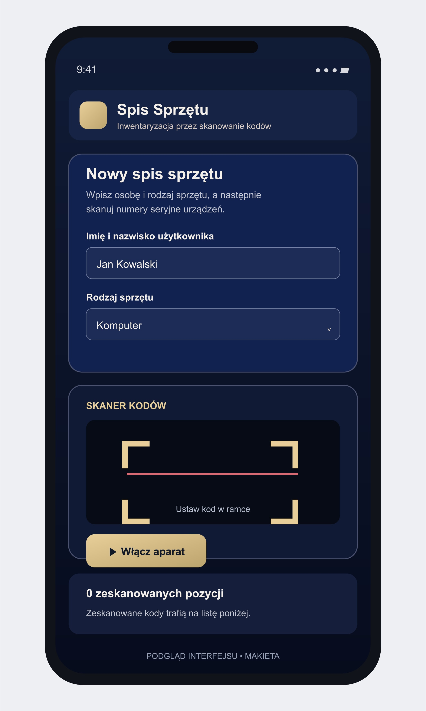
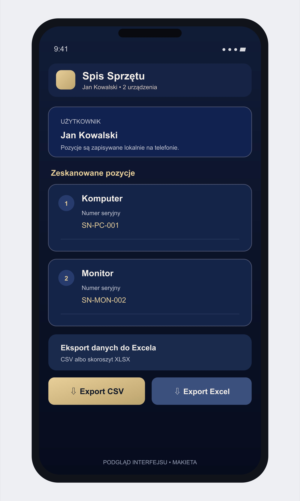

# Inwentaryzacja QR — spis sprzętu na Androidzie

Prosta aplikacja Android do spisu wyposażenia przypisanego do użytkowników. Wpisz imię i nazwisko, wybierz rodzaj sprzętu (np. komputer albo monitor), a następnie skanuj kody QR lub kreskowe z numerami seryjnymi kolejnych urządzeń. Każdy odczyt zapisuje się jako osobna pozycja z osobą, typem sprzętu i numerem seryjnym.

## Jak działa spis

1. Wpisz imię i nazwisko użytkownika.
2. Wybierz typ urządzenia.
3. Uruchom kamerę i zeskanuj numer seryjny z QR albo kodu kreskowego.
4. Zmień typ sprzętu i skanuj kolejne rzeczy tej samej osoby.
5. Naciśnij **Export CSV**, aby zapisać listę i zaimportować ją w Excelu.

W kodzie aplikacji nie ma limitu liczby pracowników. Możesz wpisać kolejną osobę i skanować jej urządzenia; każdy skan jest osobnym rekordem przypisanym do wpisanego użytkownika. Dane są przechowywane lokalnie na tym telefonie, więc regularnie eksportuj CSV lub XLSX jako kopię i przenieś plik na komputer. Ten sam numer seryjny jest wykrywany jako duplikat.

## Excel i CSV

CSV zawiera osobne kolumny dla rodzaju sprzętu, użytkownika i numeru seryjnego. W polskiej wersji Excela wybierz **Dane → Z tekstu/CSV**, kodowanie **UTF-8** oraz separator **przecinek**. Alternatywnie użyj w aplikacji eksportu XLSX, który otwiera się bezpośrednio jako skoroszyt.

## Podgląd interfejsu

Poniższe podglądy w formacie JPG pokazują przykładowy układ ekranu na telefonie. To makiety interfejsu, nie zrzuty z uruchomionego urządzenia.

## Projekt i budowanie APK

Interfejs i skaner są też dostępne do przeglądania w katalogu `root/`. Kompletny projekt Android Studio i wszystkie źródła można pobrać jako [pakiet źródłowy](source/spis-sprzetu-zrodla-android.zip). Manifest Androida deklaruje użycie aparatu; system powinien poprosić o dostęp przy pierwszym uruchomieniu skanowania.

Wymagania: Android Studio, Android SDK 36, JDK 21 oraz Node.js 22 lub nowszy.

1. Rozpakuj pakiet źródłowy.
2. Uruchom `npm install` w katalogu projektu.
3. Wykonaj `npx cap sync android`.
4. Otwórz katalog `android` w Android Studio albo w nim uruchom `gradlew.bat assembleDebug`.
5. APK debug znajdziesz w `android/app/build/outputs/apk/debug/app-debug.apk`.

## Status sprawdzenia

Poprawiony APK debug został zbudowany przez Gradle, a jego manifest zawiera uprawnienie CAMERA. Nie wykonano testu skanowania na fizycznym telefonie ani działającym emulatorze; przed użyciem sprawdź kamerę na docelowym urządzeniu.

## Licencja i pochodzenie

Projekt jest udostępniany na licencji MIT (plik [LICENSE](LICENSE)). Aplikacja bazuje na [AssetSnap IT Lens](https://github.com/conductorhythmn/android-it-inventory-scanner), również na licencji MIT, z dodanym przepływem spisu sprzętu przypisanego do użytkownika.
